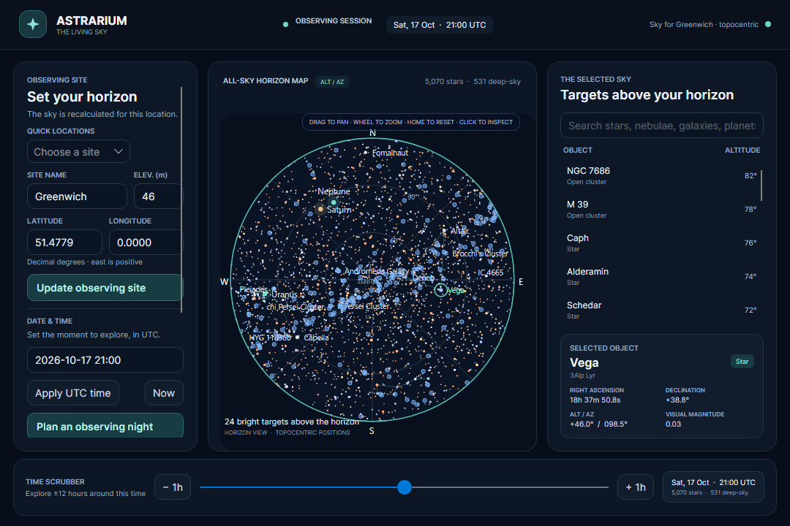
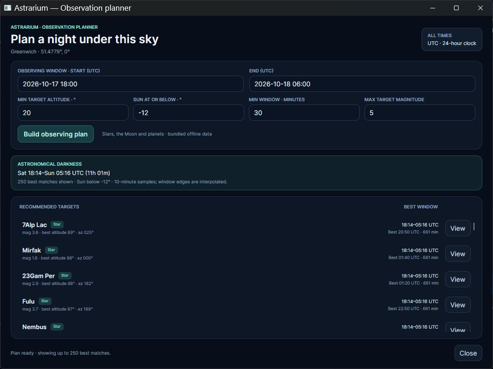

# Astrarium for Avalonia

This repository contains a cross-platform Avalonia port of [Astrarium](https://github.com/Astrarium/Astrarium), the open-source desktop planetarium. The upstream app is a substantial Windows WPF/WinForms application; this project preserves its astronomical purpose and calculations while rebuilding the experience for Windows, macOS, Linux, and WebAssembly browsers from a shared Avalonia UI.

## Current status

The observing workflow loads a licensed catalog of 5,070 naked-eye stars, computes local sky positions with Astrarium's VSOP87/ELP2000 algorithms, and draws a horizon chart with featured asterisms and solar-system bodies. It supports site/time changes, remembers observer/time/layer choices across restarts, and includes search and selection, keyboard object navigation, drag-to-pan, wheel zoom, Home reset, chart-layer toggles, and object details. Its observation planner searches a UTC observing window and reports astronomical darkness plus target windows filtered by minimum altitude, Sun altitude, magnitude, and minimum duration; choosing a result jumps to that target's best sampled time. The planner is bounded to the bundled stars, Moon, and planets rather than the original plugin catalog.

The current [Preview 7 release](https://github.com/shobhit1kapoor/astrarium-avalonia-port-challenge/releases/tag/v0.1.0-preview.7) packages a browser host alongside the shared Avalonia desktop app. The same observing workflow runs as self-contained desktop builds or a static WebAssembly site. Try the [live browser demo](https://shobhit1kapoor.github.io/astrarium-avalonia-port-challenge/); the downloadable browser build also works offline after download and keeps preferences in browser storage when available. Preview 7 was built from commit `fa82fc2` and passed all 109 tests, self-contained publishing, and window-open checks on Windows x64, Linux x64, macOS Intel, and Apple silicon in [desktop CI run #39041985725](https://github.com/shobhit1kapoor/astrarium-avalonia-port-challenge/actions/runs/39041985725). The WebAssembly site passed its separate build and package checks in [browser CI run #39041985734](https://github.com/shobhit1kapoor/astrarium-avalonia-port-challenge/actions/runs/39041985734), then the browser flow was exercised. The current main branch also passed the four-RID desktop checks in [run #39042339372](https://github.com/shobhit1kapoor/astrarium-avalonia-port-challenge/actions/runs/39042339372) and deployed the public Pages demo in [run #39042339405](https://github.com/shobhit1kapoor/astrarium-avalonia-port-challenge/actions/runs/39042339405). Desktop CI uses hosted runners; macOS/Linux were not physically tested on local hardware.

## Download and run

The desktop archives are self-contained .NET 10 builds; no .NET installation is required. Extract your operating-system archive and launch the executable from that folder. The browser archive is a static site: extract it, then serve the folder over HTTP (for example, `python -m http.server 8000 --directory <folder>`) and open the local address in a WebAssembly-capable browser. Do not open `index.html` through `file://` because browser module loading requires HTTP.

| Platform | Download | Launch |
| --- | --- | --- |
| Windows x64 | [astrarium-windows-x64.tar.gz](https://github.com/shobhit1kapoor/astrarium-avalonia-port-challenge/releases/download/v0.1.0-preview.7/astrarium-windows-x64.tar.gz) | `Astrarium.Avalonia.exe` |
| Linux x64 | [astrarium-linux-x64.tar.gz](https://github.com/shobhit1kapoor/astrarium-avalonia-port-challenge/releases/download/v0.1.0-preview.7/astrarium-linux-x64.tar.gz) | `./Astrarium.Avalonia` in a desktop session |
| macOS Intel | [astrarium-macos-x64.tar.gz](https://github.com/shobhit1kapoor/astrarium-avalonia-port-challenge/releases/download/v0.1.0-preview.7/astrarium-macos-x64.tar.gz) | `./Astrarium.Avalonia` |
| macOS Apple silicon | [astrarium-macos-arm64.tar.gz](https://github.com/shobhit1kapoor/astrarium-avalonia-port-challenge/releases/download/v0.1.0-preview.7/astrarium-macos-arm64.tar.gz) | `./Astrarium.Avalonia` |
| Browser (WebAssembly) | [astrarium-browser-wasm.tar.gz](https://github.com/shobhit1kapoor/astrarium-avalonia-port-challenge/releases/download/v0.1.0-preview.7/astrarium-browser-wasm.tar.gz) | Serve extracted files over HTTP, then open in a WebAssembly-capable browser |

SHA-256 hashes for all five archives are in [`SHA256SUMS.txt`](https://github.com/shobhit1kapoor/astrarium-avalonia-port-challenge/releases/download/v0.1.0-preview.7/SHA256SUMS.txt). Desktop builds are portable archives rather than installers. The live demo and downloadable browser archive are static WebAssembly sites with no backend; the archive can also be served locally over HTTP.

## Try the observing flow

1. Launch the app; it opens directly into an offline sky for Greenwich.
2. Choose a quick location or enter decimal-degree coordinates, apply the site, and set a date and time in UTC.
3. Search for a star or planet, select it from the horizon list, and inspect its altitude, azimuth, right ascension, declination, and magnitude. Drag the chart to pan, use the wheel to zoom, and press Home to reset.
4. Select **Plan an observing night**, set a UTC time range and visibility limits, then build the plan. Select **View** on a recommendation to return to the chart at that target's best sampled time.

## Before and after

The original screenshot is linked from the pinned upstream repository revision; it is not copied into this repository. The Avalonia image is a deterministic render of the production main window at its 1,080 × 720 minimum logical size; the packaged Windows app was launched and reviewed separately.

| Original Astrarium (WPF) | Astrarium for Avalonia |
| --- | --- |
|  |  |

### Observation planner

The Avalonia planner carries over the upstream planner's central observing filters for the objects included in this port. Plan times are UTC. The current implementation samples the calculated sky every 10 minutes by default and linearly interpolates window edges, so event times are estimates at that resolution.

## Migration report

### What moved and what changed

The upstream application targets .NET Framework 4.5.1 and composes a WPF/WinForms desktop UI around a plugin system. The astronomy library was the cleanest reusable boundary: `Astrarium.Algorithms` and its coefficient resources were retargeted to .NET 10, while the app shell, MVVM presentation, horizon-map renderer, input flow, and packaging were rebuilt with Avalonia. The main and observing-planner workflows now live in `Astrarium.Avalonia.Shared`; thin desktop and browser hosts adapt window-based and single-view lifetimes. Preferences use a Core interface with atomic file persistence on desktop and browser `localStorage` with an in-memory fallback. Source-generated JSON metadata supports trimming in the browser publish. The port carries forward the upstream MIT notices. The 5,070-star HYG subset has its own CC BY-SA 4.0 attribution and reproducible source record in [Data notices](docs/DATA_NOTICES.md).

The port preserves a useful observing loop—set a site and UTC time, inspect and navigate a calculated sky, search/select targets, plan a night under altitude and twilight constraints, and jump from a recommendation to the chart. It does not port the upstream plugin host or claim parity for deep-sky catalogs, telescope control, satellites, event prediction, saved/imported plans, or other plugins. Those remain deferred rather than represented by placeholders.

### Migration effort and cost

This is a solo, AI-assisted port. The first public implementation commit was made at **11:57:17 UTC on October 17, 2026**. Preview 3 was published at **12:46:32 UTC** (49 minutes 15 seconds later), Preview 4 with the planner at **13:17:39 UTC** (1 hour 20 minutes 22 seconds later), Preview 5 at **13:54:05 UTC** (1 hour 56 minutes 48 seconds later), Preview 6 with the shared browser host at **14:38:08 UTC** (2 hours 40 minutes 51 seconds later), and Preview 7 with the updated shared app and downloadable browser build at **14:52:50 UTC** (2 hours 55 minutes 33 seconds later). These are elapsed wall-clock windows, not active person-hours; active hours were not tracked. No paid API, dataset, or commercial UI component is required. The app is offline by default and uses the upstream MIT algorithms plus the separately licensed HYG subset.

### What was harder than expected

- Retargeting the algorithm project was easier than moving the application: the original shell and most plugins depend on WPF, WinForms, `System.Drawing`, or a WinForms-hosted OpenGL renderer.
- Reusing a code license did not clear the catalog licenses. The port therefore ships a smaller, separately attributed catalog rather than copying every upstream asset.
- Preferences needed their own migration boundary: required schema fields, bounded reads, safe fallback for corrupt data, and a flushed temporary file before replacement keep restarts predictable without entangling settings with chart calculations.
- One inherited refraction test passed solar diameter into the current API's air-pressure parameter. The test now calls the API correctly. The legacy Carrington fit also differs from a modern 2021 reference by about 0.0447°; that inherited limitation is recorded rather than hidden behind a looser tolerance.
- CI package success is not the same as launching the native window. The workflow now has per-OS launch smoke checks; actual CI results and local-device checks are listed separately below.
- The observation planner needed a portable time-window implementation rather than a WPF dialog. Its result edges are interpolated from a bounded sampling interval, and the README states that precision explicitly instead of implying exact rise/set timestamps. It currently plans against the bundled stars, Moon, and planets; it does not reproduce the original plugin ecosystem or deep-sky catalog.
- Extending the desktop port to WebAssembly exposed a second Avalonia lifetime model: browser apps are single-view, so the desktop planner window became an inline planner panel in the shared browser view. The browser host uses a static package and JavaScript storage bridge; the desktop still presents the planner as a native window.
- Hosting the browser build required configuring a project Pages deployment and validating the app at the repository's project subpath. The hosted version remains static and has no server-side state.

### Current limits

This port includes 5,070 naked-eye stars, the Sun, Moon, and seven planets, but not the full upstream object/plugin catalog. The observation planner does not yet include deep-sky targets, object-specific observing constraints, Moon-separation scoring, weather, saved/imported plans, or telescope integration. It uses 10-minute default samples with linear boundary interpolation. The chart uses a custom polar horizon projection with a few featured asterisms. The browser version is a static WebAssembly site with no backend or server-side state, available as a hosted Pages demo and a downloadable package. The Windows app and both planner/main windows have been visually exercised locally, including their declared minimum dimensions at the host's default display scale. Linux/macOS launch checks are runner-based, and no physical test devices for those systems are claimed.

## Run from source

Install the .NET 10 SDK, then run `dotnet run --project src/Astrarium.Avalonia/Astrarium.Avalonia.csproj`. The bundled catalog and ephemerides work offline; no account, API key, or network connection is needed for the observing view. The browser host is built separately by `.github/workflows/astrarium-browser.yml`; the desktop solution does not require WebAssembly workloads for ordinary builds and tests.

## Project notes

- [Astrarium migration brief](docs/ASTRARIUM_MIGRATION_BRIEF.md) — upstream facts, licensing risks, port boundary, and migration decisions.
- [Astrarium delivery plan](docs/ASTRARIUM_PORT_PLAN.md) — criteria mapping, acceptance checks, and six-day execution schedule.
- [Data notices](docs/DATA_NOTICES.md) — separate catalog/source licenses and reproducible catalog provenance.
- [Challenge plan](docs/PORT_CHALLENGE_PLAN.md) — official rules and entry checklist.
- [Upstream Astrarium](https://github.com/Astrarium/Astrarium) — behavioral reference and original project.

## Verification so far

- Commit `40b4ed3` passed all 109 tests, self-contained publishing, packaging, and actual `Window.Opened` checks for `win-x64`, `linux-x64`, `osx-x64`, and `osx-arm64` in [desktop CI run #39041007593](https://github.com/shobhit1kapoor/astrarium-avalonia-port-challenge/actions/runs/39041007593). The workflow verifies that the native window opens on each runner before publishing that platform's archive.
- The separate browser workflow installs the WebAssembly workload, publishes Avalonia with the native Skia rendering assets, checks fingerprinted entry/storage/runtime modules and WebAssembly files, and packages the static site. The exact Preview 7 browser artifact was built in [browser CI run #39041985734](https://github.com/shobhit1kapoor/astrarium-avalonia-port-challenge/actions/runs/39041985734). The hosted static app was opened at the GitHub Pages project path; the chart rendered, the planner opened, and **View** returned a recommendation to its chart time. The Pages deploy and current-main browser package passed in [run #39042339405](https://github.com/shobhit1kapoor/astrarium-avalonia-port-challenge/actions/runs/39042339405).
- The exact four desktop archives and browser site from the Preview 7 CI runs are published in [Preview 7](https://github.com/shobhit1kapoor/astrarium-avalonia-port-challenge/releases/tag/v0.1.0-preview.7), with SHA-256 checksums for all five artifacts. The [hosted browser demo](https://shobhit1kapoor.github.io/astrarium-avalonia-port-challenge/) is deployed from the current main branch.
- The actual main and planner windows are rendered at 100%, 125%, 150%, and 200% with Avalonia's headless platform at their minimum logical sizes. The main window is also checked at its 1,500 × 960 default logical size. Tests check accessible names on interactive fields and lists, finite layout bounds, stable logical client sizes, and raster dimensions that track the requested scale; captures at fractional and 200% scales were visually reviewed. This simulates Avalonia scaling and does not verify native Windows monitor changes.
- The packaged Windows x64 Preview 4 app and planner opened locally. The planner generated darkness and target windows, and a recommendation returned to the chart at its best sampled UTC time. Minimum dimensions were reviewed for the 1,080 × 720 main window and 780 × 600 planner. Search, empty search, map/list selection, arrow navigation, pan, zoom, and reset were checked on the Windows host. Preview 5 carries the added accessibility names and passed the hosted Windows window-open check.
- Linux and macOS launch checks are hosted-runner-only; no physical devices are claimed. Native Windows monitor scaling has not been checked.

The observation planner was also exercised end to end on Windows: it generated darkness and target windows, scrolled the recommendation list at its minimum size, and returned a selected target to the chart at its best sampled UTC time. Native Windows display scaling and physical macOS/Linux devices have not been checked.

This is a focused first port of Astrarium's observing workflow; it does not claim parity with the original plugin ecosystem.

## Challenge

The Avalonia Port Challenge closes **October 23, 2026 at 23:59 UTC** (**18:59 America/Chicago**). Entry requirements and judging criteria are tracked in `docs/PORT_CHALLENGE_PLAN.md` and must be checked again before submission.
