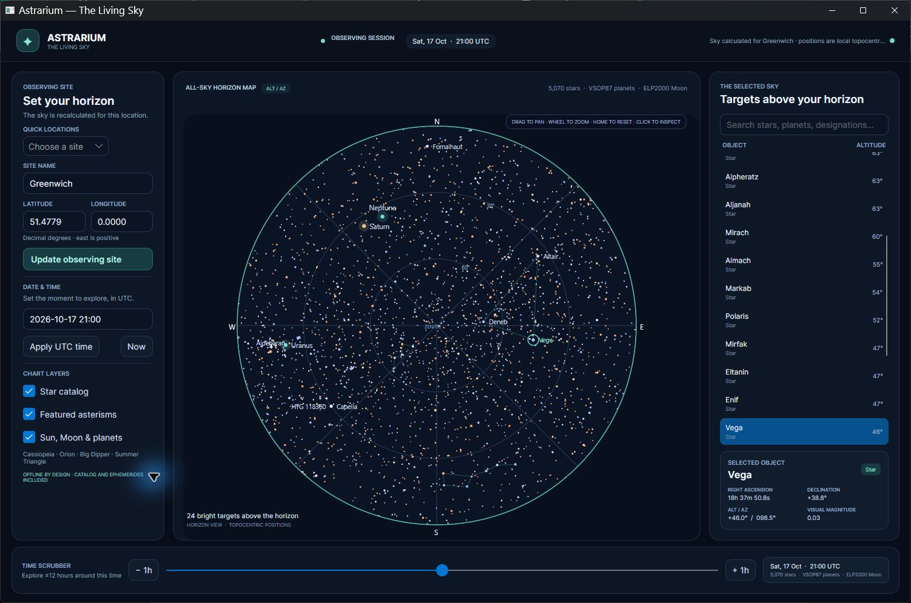

# Astrarium for Avalonia

This repository contains a cross-platform Avalonia port of [Astrarium](https://github.com/Astrarium/Astrarium), the open-source desktop planetarium. The upstream app is a substantial Windows WPF/WinForms application; this project preserves its astronomical purpose and calculations while rebuilding the desktop experience for Windows, macOS, and Linux.

## Current status

The observing workflow loads a licensed catalog of 5,070 naked-eye stars, computes local sky positions with Astrarium's VSOP87/ELP2000 algorithms, and draws a horizon chart with featured asterisms and solar-system bodies. It supports site/time changes, remembers observer/time/layer choices across restarts, and includes search and selection, keyboard object navigation, drag-to-pan, wheel zoom, Home reset, chart-layer toggles, and object details. Its observation planner searches a UTC observing window and reports astronomical darkness plus target windows filtered by minimum altitude, Sun altitude, magnitude, and minimum duration; choosing a result jumps to that target's best sampled time. The planner is bounded to the bundled stars, Moon, and planets rather than the original plugin catalog.

The current [Preview 4 release](https://github.com/shobhit1kapoor/astrarium-avalonia-port-challenge/releases/tag/v0.1.0-preview.4) adds the offline observing-night planner, with target and darkness windows filtered by altitude, twilight, visual magnitude, and minimum duration. Commit `c2b63eb` passed all 106 tests, self-contained publishing, and actual window-open checks on Windows x64, Linux x64, macOS Intel, and macOS Apple silicon in [hosted CI run #39035676876](https://github.com/shobhit1kapoor/astrarium-avalonia-port-challenge/actions/runs/39035676876). The packaged Windows archive and its planner were launched and reviewed locally; macOS and Linux were verified on hosted runners, not physical devices.

## Download and run

These portable archives are self-contained .NET 10 builds; no .NET installation is required. Extract the archive for your operating system and launch the executable from the extracted folder. Preview 4 is the latest published build.

| Platform | Download | Launch |
| --- | --- | --- |
| Windows x64 | [astrarium-windows-x64.tar.gz](https://github.com/shobhit1kapoor/astrarium-avalonia-port-challenge/releases/download/v0.1.0-preview.4/astrarium-windows-x64.tar.gz) | `Astrarium.Avalonia.exe` |
| Linux x64 | [astrarium-linux-x64.tar.gz](https://github.com/shobhit1kapoor/astrarium-avalonia-port-challenge/releases/download/v0.1.0-preview.4/astrarium-linux-x64.tar.gz) | `./Astrarium.Avalonia` in a desktop session |
| macOS Intel | [astrarium-macos-x64.tar.gz](https://github.com/shobhit1kapoor/astrarium-avalonia-port-challenge/releases/download/v0.1.0-preview.4/astrarium-macos-x64.tar.gz) | `./Astrarium.Avalonia` |
| macOS Apple silicon | [astrarium-macos-arm64.tar.gz](https://github.com/shobhit1kapoor/astrarium-avalonia-port-challenge/releases/download/v0.1.0-preview.4/astrarium-macos-arm64.tar.gz) | `./Astrarium.Avalonia` |

SHA-256 hashes for the four archives are in [`SHA256SUMS.txt`](https://github.com/shobhit1kapoor/astrarium-avalonia-port-challenge/releases/download/v0.1.0-preview.4/SHA256SUMS.txt). These are portable archives rather than installers.

## Before and after

The original screenshot is linked from the pinned upstream repository revision; it is not copied into this repository. The Avalonia screenshot is captured from the running port.

| Original Astrarium (WPF) | Astrarium for Avalonia |
| --- | --- |
|  |  |

### Observation planner

The Avalonia planner carries over the upstream planner's central observing filters for the objects included in this port. Plan times are UTC. The current implementation samples the calculated sky every 10 minutes by default and linearly interpolates window edges, so event times are estimates at that resolution.

## Migration report

### What moved and what changed

The upstream application targets .NET Framework 4.5.1 and composes a WPF/WinForms desktop UI around a plugin system. The astronomy library was the cleanest reusable boundary: `Astrarium.Algorithms` and its coefficient resources were retargeted to .NET 10, while the app shell, MVVM presentation, horizon-map renderer, input flow, and packaging were rebuilt with Avalonia. The port carries forward the upstream MIT notices. The 5,070-star HYG subset has its own CC BY-SA 4.0 attribution and reproducible source record in [Data notices](docs/DATA_NOTICES.md).

The port preserves a useful observing loop—set a site and UTC time, inspect and navigate a calculated sky, search/select targets, plan a night under altitude and twilight constraints, and jump from a recommendation to the chart. It does not port the upstream plugin host or claim parity for deep-sky catalogs, telescope control, satellites, event prediction, saved/imported plans, or other plugins. Those remain deferred rather than represented by placeholders.

### Migration effort and cost

This is a solo, AI-assisted port. The first public implementation commit was made at **11:57:17 UTC on October 17, 2026**. Preview 3 was published at **12:46:32 UTC** (49 minutes 15 seconds later), and Preview 4 with the planner at **13:17:39 UTC** (1 hour 20 minutes 22 seconds after that first commit). These are elapsed wall-clock windows, not active person-hours; active hours were not tracked. No paid API, dataset, or commercial UI component is required. The app is offline by default and uses the upstream MIT algorithms plus the separately licensed HYG subset.

### What was harder than expected

- Retargeting the algorithm project was easier than moving the application: the original shell and most plugins depend on WPF, WinForms, `System.Drawing`, or a WinForms-hosted OpenGL renderer.
- Reusing a code license did not clear the catalog licenses. The port therefore ships a smaller, separately attributed catalog rather than copying every upstream asset.
- Preferences needed their own migration boundary: required schema fields, bounded reads, safe fallback for corrupt data, and a flushed temporary file before replacement keep restarts predictable without entangling settings with chart calculations.
- One inherited refraction test passed solar diameter into the current API's air-pressure parameter. The test now calls the API correctly. The legacy Carrington fit also differs from a modern 2021 reference by about 0.0447°; that inherited limitation is recorded rather than hidden behind a looser tolerance.
- CI package success is not the same as launching the native window. The workflow now has per-OS launch smoke checks; actual CI results and local-device checks are listed separately below.
- The observation planner needed a portable time-window implementation rather than a WPF dialog. Its result edges are interpolated from a bounded sampling interval, and the README states that precision explicitly instead of implying exact rise/set timestamps. It currently plans against the bundled stars, Moon, and planets; it does not reproduce the original plugin ecosystem or deep-sky catalog.

### Current limits

This port includes 5,070 naked-eye stars, the Sun, Moon, and seven planets, but not the full upstream object/plugin catalog. The observation planner does not yet include deep-sky targets, object-specific observing constraints, Moon-separation scoring, weather, saved/imported plans, or telescope integration. It uses 10-minute default samples with linear boundary interpolation. The chart uses a custom polar horizon projection with a few featured asterisms. The Windows app and both planner/main windows have been visually exercised locally, including their declared minimum dimensions at the host's default display scale. Linux/macOS launch checks are runner-based, and no physical test devices for those systems are claimed.

## Run from source

Install the .NET 10 SDK, then run `dotnet run --project src/Astrarium.Avalonia/Astrarium.Avalonia.csproj`. The bundled catalog and ephemerides work offline; no account, API key, or network connection is needed for the observing view.

## Project notes

- [Astrarium migration brief](docs/ASTRARIUM_MIGRATION_BRIEF.md) — upstream facts, licensing risks, port boundary, and migration decisions.
- [Astrarium delivery plan](docs/ASTRARIUM_PORT_PLAN.md) — criteria mapping, acceptance checks, and six-day execution schedule.
- [Data notices](docs/DATA_NOTICES.md) — separate catalog/source licenses and reproducible catalog provenance.
- [Challenge plan](docs/PORT_CHALLENGE_PLAN.md) — official rules and entry checklist.
- [Upstream Astrarium](https://github.com/Astrarium/Astrarium) — behavioral reference and original project.

## Verification so far

- `dotnet test Astrarium.Port.sln --configuration Release --no-restore`: 106 tests passed (92 retained Astrarium algorithm checks and 14 port-core checks), zero failures.
- `dotnet build Astrarium.Port.sln --configuration Release --no-restore`: Windows-host Release solution build succeeded with zero warnings and errors.
- Hosted CI [run #39035676876](https://github.com/shobhit1kapoor/astrarium-avalonia-port-challenge/actions/runs/39035676876) passed all tests, self-contained publishing, and actual `Window.Opened` checks for `win-x64`, `linux-x64`, `osx-x64`, and `osx-arm64`. Its artifacts were verified, checksummed, and published in [Preview 4](https://github.com/shobhit1kapoor/astrarium-avalonia-port-challenge/releases/tag/v0.1.0-preview.4).
- The packaged Windows x64 Preview 4 app and planner opened locally. The planner generated darkness and target windows, and a recommendation returned to the chart at its best sampled UTC time. Minimum dimensions were reviewed for the 1,080 × 720 main window and 780 × 600 planner. Search, empty search, map/list selection, arrow navigation, pan, zoom, and reset were checked on the Windows host.
- Linux and macOS launch checks are hosted-runner-only; no physical devices are claimed. Non-default Windows scaling has not been checked.

The observation planner was also exercised end to end on Windows: it generated darkness and target windows, scrolled the recommendation list at its minimum size, and returned a selected target to the chart at its best sampled UTC time. Non-default Windows scaling factors and physical macOS/Linux devices have not been checked.

This is a focused first port of Astrarium's observing workflow; it does not claim parity with the original plugin ecosystem.

## Challenge

The Avalonia Port Challenge closes **October 23, 2026 at 23:59 UTC** (**18:59 America/Chicago**). Entry requirements and judging criteria are tracked in `docs/PORT_CHALLENGE_PLAN.md` and must be checked again before submission.
